ML/AI Engineer building agentic AI systems and RL environments. Know more here: https://vidit-ostwal.github.io/

## 🚢 Projects

- [Automating 3D Survival Playing](https://github.com/Vidit-Ostwal/Automating-3DSurvival-Playing) — vision-language agent that plays Survival 3D on YouTube Playables.
- [Automatic UI Fixing Harness](https://github.com/Vidit-Ostwal/Automatic-UI-Fixing-Harness) — black-box UI defect discovery via Playwright + LLM verification.
- [Understanding Prime Env Skill](https://github.com/Vidit-Ostwal/Understanding-prime-env) — generates HTML reports explaining Prime Intellect verifiers environments.
- [Maze Bench](https://github.com/Vidit-Ostwal/Maze-Bench-OpenEnv) — ice-sliding multi-player maze environment on OpenEnv.
- [Price Negotiation RL](https://github.com/Vidit-Ostwal/price-negotiation-rl-OpenEnv) — LLM agent negotiates prices against an LLM seller.
- [RLM Demo](https://github.com/Vidit-Ostwal/RLM-demo) — interactive console for RL models and agentic systems.
- [MakeMyDocsBot](https://github.com/Vidit-Ostwal/MakeMyDocsBot) — CrewAI bot that auto-syncs multilingual docs on every push.
